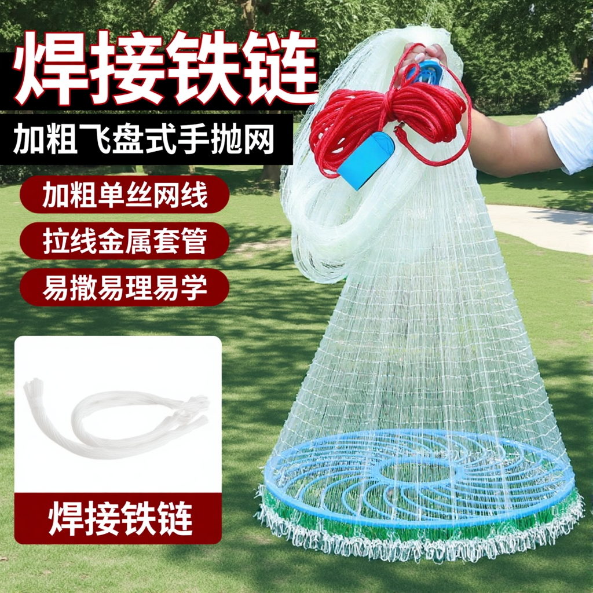
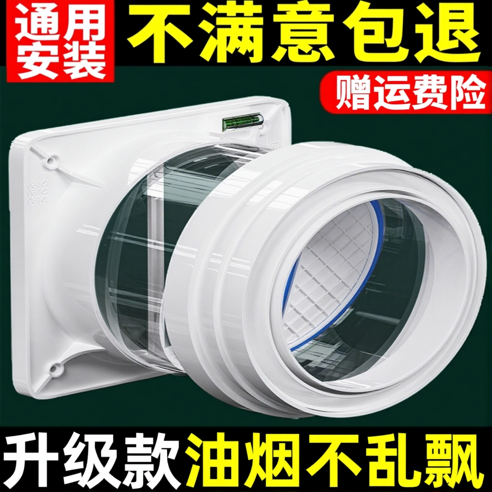
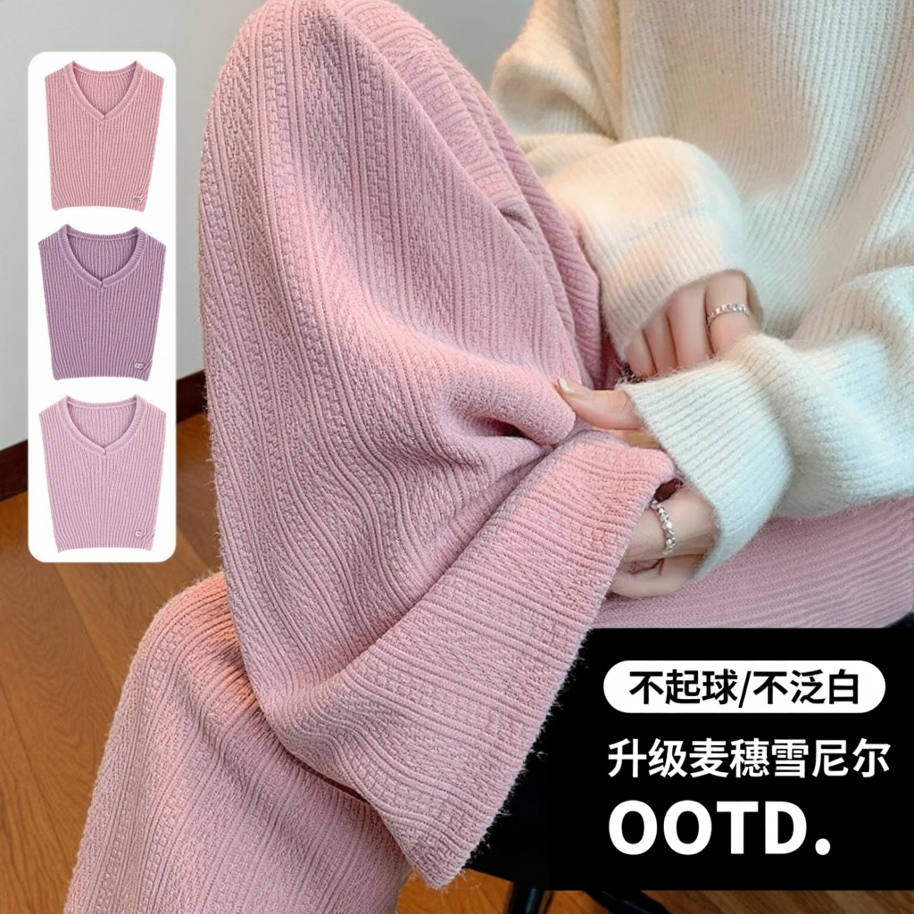
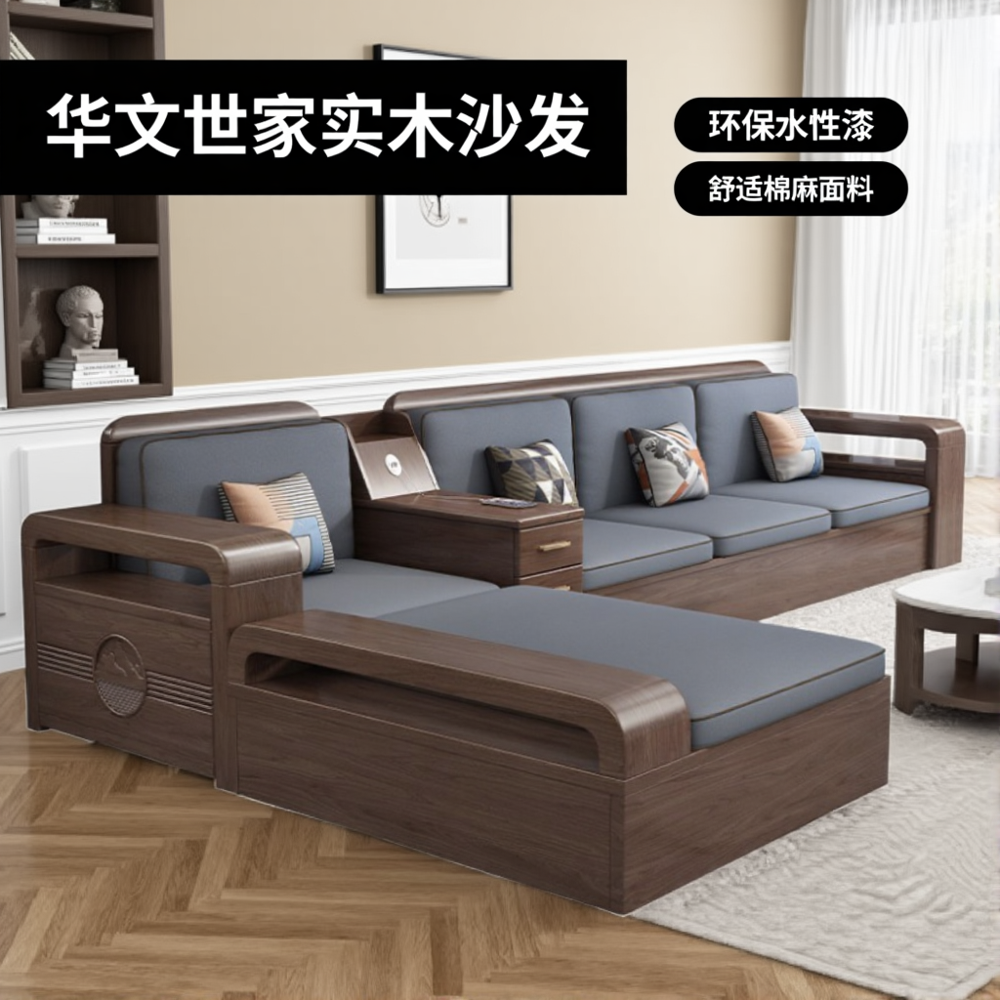

<div align="center">

# SIMPLEPOSTER

### A Simple Baseline for Product Poster Generation

[](https://arxiv.org/abs/2605.08784)
[](https://github.com/Alibaba-VELLDEPTH/SIMPLEPOSTER)
[](https://huggingface.co/Alibaba-VELLDEPTH/Flux-SimplePoster)
[](https://arxiv.org/abs/2605.08784)

This repository provides a lightweight, local single-image inference entry point for SIMPLEPOSTER.

</div>

## Links

- Paper: [SIMPLEPOSTER: A Simple Baseline for Product Poster Generation](https://arxiv.org/abs/2605.08784)
- Code: [Alibaba-VELLDEPTH/SIMPLEPOSTER](https://github.com/Alibaba-VELLDEPTH/SIMPLEPOSTER)
- Checkpoint: [Alibaba-VELLDEPTH/Flux-SimplePoster](https://huggingface.co/Alibaba-VELLDEPTH/Flux-SimplePoster)

## Overview

SIMPLEPOSTER is a simple baseline for product poster generation. This public release contains only the local inference entry point and its Python dependencies. Training, data processing, and evaluation code are not included.

## Showcase

The examples below are deliberately difficult: dense multi-line Chinese, long copy, mixed digits, English punctuation, and complex product silhouettes. All displayed target lines were exact OCR matches (`mean NED = 1.0`). Inputs, masks, full prompts, layout coordinates, fixed settings, and checksums are included in the [reproducible showcase](examples/showcase/README.md).

| 6 exact lines | 5 exact lines | 4 long lines |
|:---:|:---:|:---:|
|  |  |  |
| Dense repeated Chinese copy | Long top and bottom copy | Long material-description copy |

| Digits + Chinese | English + punctuation | Complex furniture subject |
|:---:|:---:|:---:|
|  |  |  |
| `2024` mixed with Chinese | `OOTD.` and `/` mixed with Chinese | Three exact lines with a detailed scene |

## Environment

- Linux with a CUDA GPU (48 GB or more VRAM recommended)
- Python 3.10
- CUDA 12.x

```bash
python -m venv .venv
source .venv/bin/activate
bash install_local.sh
```

The installer uses the public Python package index only. The model runtime imported under `aigc_train.models` must also be available on `PYTHONPATH`; it is not downloaded by the installer. The inference program reads model assets exclusively from the local paths supplied on the command line.

## Model preparation

Prepare the following local model assets:

1. SIMPLEPOSTER DiT checkpoint `dit.pth`
2. FLUX.1-dev VAE `ae.safetensors`
3. A complete `Qwen2.5-VL-7B-Instruct/` directory

Download the SIMPLEPOSTER checkpoint from Hugging Face:

```bash
hf download Alibaba-VELLDEPTH/Flux-SimplePoster dit.pth --local-dir models
```

Obtain the FLUX.1-dev and Qwen2.5-VL assets from their official publishers and follow their respective licenses. Inference does not make network requests; all assets are loaded from local paths.

## Quick inference

For an RGBA input, the alpha channel is converted into an inpainting mask: transparent regions are generated and opaque product regions are preserved.

```bash
python infer.py \
  --image inputs/product.png \
  --prompt '一只粉色玩具喷水枪，蓝色夏日水面背景。' \
  --checkpoint models/dit.pth \
  --vae models/ae.safetensors \
  --qwen-dir models/Qwen2.5-VL-7B-Instruct \
  --output outputs/poster.png
```

For an RGB input, provide a mask explicitly. White pixels mark regions to generate.

```bash
python infer.py \
  --image inputs/product.jpg \
  --mask inputs/mask.png \
  --prompt '一只粉色玩具喷水枪，蓝色夏日水面背景。' \
  --checkpoint models/dit.pth \
  --vae models/ae.safetensors \
  --qwen-dir models/Qwen2.5-VL-7B-Instruct \
  --output outputs/poster.png
```

## Text layout control

Use `--ocr-json inputs/ocr.json` to specify text and spatial positions. The file may contain the OCR object directly or wrap it in an `ocr_result` field:

```json
{
  "texts": ["夏日浓情戏水"],
  "boxes": [[24, 96, 594, 25, 607, 162, 51, 227]],
  "info": {"width": 800, "height": 800}
}
```

The corresponding text in the prompt must use Chinese quotation marks, for example: `顶部写“夏日浓情戏水”。`

Default inference settings are `1024×1024`, `50` steps, `guidance_scale=4.5`, `guidance=30`, and `seed=100`.

## Citation

```bibtex
@article{simpleposter2026,
  title={SIMPLEPOSTER: A Simple Baseline for Product Poster Generation},
  author={Cui, Benlei and Zeng, Fangao and Jiang, Weitao and Zhai, Yuwen and Hong, Haiwen and Huang, Longtao and Xue, Hui and Shang, Wenxiang and Huang, Pipei},
  journal={arXiv preprint arXiv:2605.08784},
  year={2026}
}
```

## License

The checkpoint and all dependent models remain subject to their respective licenses and release terms.
